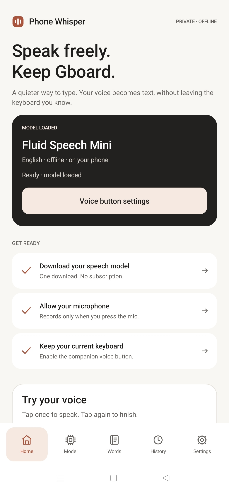
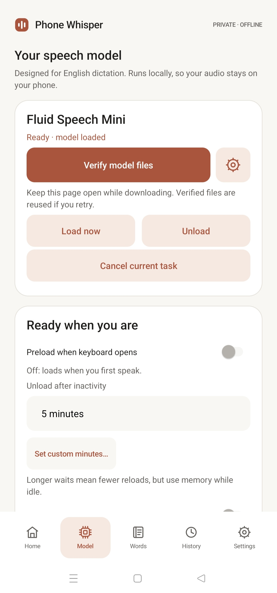
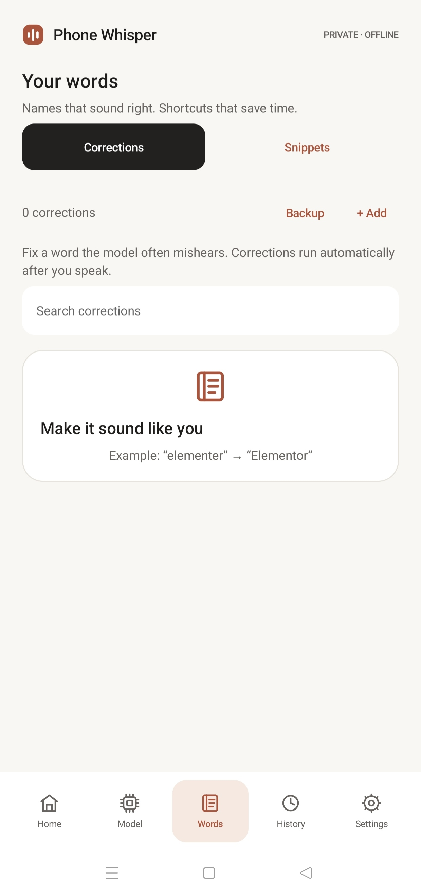
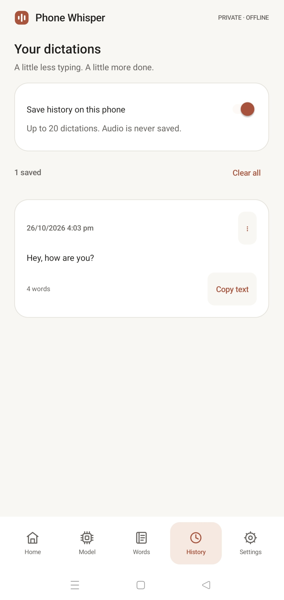
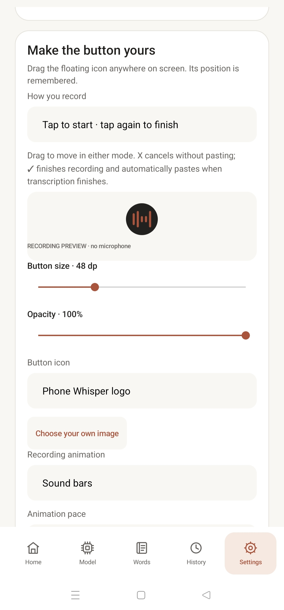
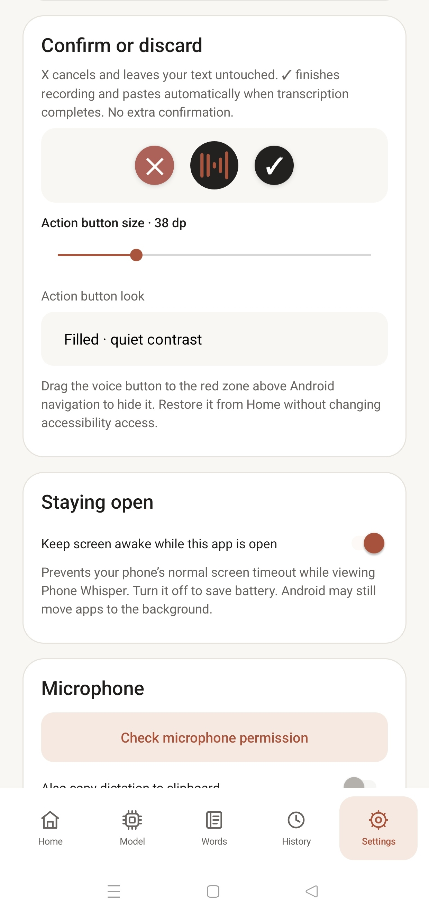

<div align="center">
  
  <h1>Phone Whisper</h1>
  <p><strong>Speak freely. Keep Gboard.</strong></p>
  <p>Beautifully simple, private voice typing for Android.<br/>A floating microphone, real offline transcription, and the keyboard you already love.</p>
  <p>
    <a href="https://github.com/BetterFuture-ai/Phone-Whisper/releases/latest"><strong>Download APK</strong></a>
    · <a href="INSTALL.md">Installation guide</a>
    · <a href="#screenshots">Screenshots</a>
    · <a href="#source-code-guide">Browse the code</a>
  </p>
  <p>
    
    
    
    
    
  </p>
</div>

---

> [!IMPORTANT]
> **Android sideloading notice:** Google Play Protect may block the direct installation of this app in India and certain other locations **because it uses Android AccessibilityService** to work with Gboard. That is a sensitive capability, and Google may not offer an “Install anyway” button. This project is **not published on Google Play**. Please read [Installation & Play Protect](INSTALL.md#play-protect-and-app-installation) before downloading. Do not assume that an antivirus scan overrides Android's installer restrictions.

## Why Phone Whisper?

Most voice keyboards make you choose between dictation and your favorite keyboard. Phone Whisper is designed around a different idea: **keep Gboard and add a small, movable voice control whenever you need it.**

The speech model runs **on your device** using ONNX Runtime. No account, no subscription and no cloud speech-to-text service. Once you have downloaded the model, speaking and transcribing work offline.

### Highlights

- **Keep Gboard:** its swipe typing, predictions, emoji, languages and clipboard stay available.
- **One-tap voice typing:** tap the bubble to record, then tap **✓** to finish. Recognized text is inserted automatically when ready. **✕** cancels without pasting. No extra transcript confirmation step.
- **A bubble that fits your screen:** move it, resize it, choose the icon and recording animation, and customize the X/✓ control size and style.
- **Hide without losing access:** drag the bubble onto the red dismiss target. Restore it from **Home → Show floating button**.
- **Offline by design:** local Fluid Speech Mini model; microphone recordings are not submitted to a cloud transcription service.
- **Make it understand you:** custom word corrections, text snippets, and optional local transcript history.
- **Stay in control:** choose processing threads, when to preload/unload the model, session length, clipboard options, and backups.
- **Verified model files:** the ~300 MB first-time download is checked against pinned file sizes and SHA-256 hashes. An HTTPS mirror and encrypted optional Hugging Face read-only token can be configured from the **gear next to Download/Verify**.

## Screenshots

Actual screenshots from the Phone Whisper Android app. Tap any image to inspect it at full size.

<table>
<tr>
<td width="33%" align="center"><a href="Screenshots/IMG_20261026_160830.jpg"></a><br/><strong>Home</strong><br/>One glance. Ready to speak.</td>
<td width="33%" align="center"><a href="Screenshots/IMG_20261026_160841.jpg"></a><br/><strong>Model</strong><br/>Download once. Speak offline.</td>
<td width="33%" align="center"><a href="Screenshots/IMG_20261026_160851.jpg"></a><br/><strong>Words</strong><br/>Your vocabulary, your shortcuts.</td>
</tr>
<tr>
<td align="center"><a href="Screenshots/IMG_20261026_160902.jpg"></a><br/><strong>History</strong><br/>Only if you choose to save it.</td>
<td align="center"><a href="Screenshots/IMG_20261026_160915.jpg"></a><br/><strong>Customize</strong><br/>Make the bubble yours.</td>
<td align="center"><a href="Screenshots/IMG_20261026_160925.jpg"></a><br/><strong>Control</strong><br/>✕ to discard. ✓ to dictate.</td>
</tr>
</table>

## Get started

**Requirements:** Android 13+; ARM64 device; Gboard recommended; around 300 MB available for the downloaded model (plus installation and processing space). First-time setup needs internet. English dictation is the primary supported language.

1. Visit **[Releases](https://github.com/BetterFuture-ai/Phone-Whisper/releases)** and download **`PhoneWhisper.apk`**. The APK is a separate downloadable **release asset**, not part of this source repository.
2. Before installing, review [INSTALL.md](INSTALL.md), including the Play Protect warning, APK checksum and platform restrictions.
3. Open **Phone Whisper** → **Model** → **Download model** (~300 MB); keep the app in view until ready. The small **gear** next to the button holds model source configuration.
4. Open **Home → Allow your microphone**, then **Home → Keep your current keyboard** (or **Settings → Enable companion voice button**). Read the full Accessibility disclosure and choose whether to grant the service access.
5. In Android's **Settings → Accessibility → Downloaded apps / Installed services**, find **Phone Whisper voice button** and enable it. Some OnePlus/Android versions show additional explanatory screens or **View more**. Review the information before allowing this sensitive permission.
6. Open an ordinary editable text field with **Gboard**. Tap the small floating bubble and speak. Press **✓** once to finish and insert, or **✕** to discard.

For Android variants, hidden/restricted settings, troubleshooting and optional keyboard mode, see **[the illustrated setup guide](INSTALL.md)**.

## How the floating control works

```text
                 Gboard remains your keyboard
                           │
                     Tap voice bubble
                           │
                      🎙 Recording
                           │
             ┌─────────────┴──────────────┐
             │                            │
          ✕ Cancel                     ✓ Finish
             │                            │
        Discard audio               Offline speech model
        Nothing pasted                    │
                                     Same field active?
                                     │           │
                                   Yes           No
                                     │           │
                                   Paste       Discard
```

If the user switches to a different app/field or the keyboard disappears while the model is transcribing, the companion rejects the now-stale insertion. Sensitive/password fields are excluded. The voice bubble can be moved or hidden; when hidden, restore it from the app's Home screen.

## What stays private?

**Voice recognition runs on the phone.** The app does not send audio to an external speech recognition provider and does not require an account. The local model is downloaded over HTTPS and checked against a pinned manifest; internet permission is used for that download, not cloud recognition. Optional personal dictation history is **off by default**, retained in the app if enabled, and limited to 20 entries. Temporary audio is cleaned up after transcription or cancellation.

**Accessibility requires special trust.** To show the voice control alongside Gboard and insert text into other apps, Phone Whisper requests Android AccessibilityService access, which has broad potential access to the screen and text. The app gives an explicit explanation and requires the user to enable it in Android Settings. Review the [security policy](SECURITY.md) and the [Android installation limitations](PLAY-PROTECT.md).

## Source code guide

Every application Java source file is available in the repository. The index below maps each file to its job, so contributors can find what they need quickly.

### Android application — `app/src/com/jitu/fluidspeech/`

| Source file | Responsibility |
|---|---|
| [`MainActivity.java`](app/src/com/jitu/fluidspeech/MainActivity.java) | Home, Model, Words, History, Settings, model configuration popup and Accessibility disclosure |
| [`Ui.java`](app/src/com/jitu/fluidspeech/Ui.java) | Native Android reusable UI components, theme, layout helpers and icons |
| [`AppPrefs.java`](app/src/com/jitu/fluidspeech/AppPrefs.java) | On-device preferences, text history and settings storage |
| [`CompanionService.java`](app/src/com/jitu/fluidspeech/CompanionService.java) | Accessibility-based Gboard companion, editor safety and text insertion |
| [`BubbleView.java`](app/src/com/jitu/fluidspeech/BubbleView.java) | Floating microphone bubble and animated recording visuals |
| [`BubbleGestures.java`](app/src/com/jitu/fluidspeech/BubbleGestures.java) | Touch, drag, tap/hold and dismissal interactions |
| [`OverlayControls.java`](app/src/com/jitu/fluidspeech/OverlayControls.java) | Touch-friendly ✕ / ✓ actions and red hide target |
| [`SpeechController.java`](app/src/com/jitu/fluidspeech/SpeechController.java) | Audio capture, inference work queue, cancellation and lifecycle |
| [`AsrEngine.java`](app/src/com/jitu/fluidspeech/AsrEngine.java) | On-device ONNX speech inference and decoding |
| [`ModelStore.java`](app/src/com/jitu/fluidspeech/ModelStore.java) | Model download, HTTPS source selection, hash/size validation |
| [`ModelTokenStore.java`](app/src/com/jitu/fluidspeech/ModelTokenStore.java) | Android Keystore encryption of optional model access token |
| [`RuleStore.java`](app/src/com/jitu/fluidspeech/RuleStore.java) | Persistence of word corrections and spoken snippets |
| [`TextRules.java`](app/src/com/jitu/fluidspeech/TextRules.java) | Applies word replacements and snippets to recognized text |
| [`VoiceKeyboard.java`](app/src/com/jitu/fluidspeech/VoiceKeyboard.java) | Optional basic input-method keyboard, separate from Gboard companion |
| [`BenchmarkRunner.java`](app/src/com/jitu/fluidspeech/BenchmarkRunner.java) | Local model inference performance measurement |

### Build, verification and resources

| File or folder | Purpose |
|---|---|
| [`app/AndroidManifest.xml`](app/AndroidManifest.xml) | Package, permissions, accessibility and input-method services |
| [`app/res/`](app/res) | Icon, app theme, Android resources, service metadata |
| [`app/assets/model-manifest.json`](app/assets/model-manifest.json) | Pinned model files with integrity hashes and sizes |
| [`app/assets/MODEL-LICENSE.txt`](app/assets/MODEL-LICENSE.txt) and [`MODEL-NOTICE.txt`](app/assets/MODEL-NOTICE.txt) | Upstream model attribution and terms |
| [`app/assets/ONNX-RUNTIME-NOTICE.txt`](app/assets/ONNX-RUNTIME-NOTICE.txt) | ONNX Runtime notices |
| [`tools/prepare.py`](tools/prepare.py) | Prepare Android/ONNX dependencies and validation assets |
| [`tools/build.py`](tools/build.py) | Lightweight Android compilation, packaging, signing and validation |
| [`tools/test-engine.sh`](tools/test-engine.sh) | Run JVM-based offline recognition tests |
| [`tools/archive-initial-build.py`](tools/archive-initial-build.py) | Development build archival helper |
| [`tools/tidy-installers.py`](tools/tidy-installers.py) | Installer cleanup helper |
| [`tests/EngineSmokeTest.java`](tests/EngineSmokeTest.java) | Inference, cancellation and model reuse checks |
| [`tests/TextRulesTest.java`](tests/TextRulesTest.java) | Text replacement and snippet checks |

### Project documents

- [**Installation & troubleshooting**](INSTALL.md) — practical Android setup and downloads.
- [**Release notes**](RELEASE-NOTES.md) — changes, compatibility and verified limitations.
- [**Contributing**](CONTRIBUTING.md) — development/testing guide and issue checklist.
- [**Security**](SECURITY.md) — sensitive permissions, privacy and vulnerability reports.
- [**Play Protect diagnosis**](PLAY-PROTECT.md) — reproduced sideload-install limitation, official options and appeal background.
- [**Agent working rules**](AGENTS.md) — engineering/verification workflow.
- [**Goal and Progress**](Goal%20and%20Progress.md) — full product scope, success criteria and known unfinished tests.
- [**Memory**](Memory.md) — short project context for contributors.
- [**PSD**](PSD.md) — problems, solutions and documented decisions.
- [**License**](LICENSE) — MIT for original Phone Whisper source code, subject to upstream component licenses below.

## Building from source

The lightweight build uses **JDK 17**, Android SDK platform/build tools **35**, Python 3 and ARM64 ONNX Runtime dependencies. It does not need the Gradle daemon. On a clean checkout, `tools/prepare.py` downloads required third-party dependencies, including model files used for JVM smoke tests, so expect significant network/storage use. Read the script before running it.

```bash
git clone https://github.com/BetterFuture-ai/Phone-Whisper.git
cd Phone-Whisper

python3 tools/prepare.py
python3 tools/build.py
bash tools/test-engine.sh
```

`tools/build.py` creates a **new, local signing key** on first build when one is not present; its password is generated at random and stored under the **Git-ignored** `.deps/signing.json`. You may instead supply `PHONE_WHISPER_KEYSTORE`, `PHONE_WHISPER_KEYSTORE_PASSWORD`, `PHONE_WHISPER_KEY_PASSWORD` and `PHONE_WHISPER_KEY_ALIAS` environment variables. Never commit key files, passwords, model downloads or generated artifacts.

> [!WARNING]
> Your own source build is **not signed with the same key as our GitHub release APK**, so Android will not accept it as an in-place update over the published version. Keep your own signing key safe.

## Current scope and known limitations

- **Release:** v0.4.4, ARM64, Android 13+. Source and signed APK have passed local build, signature and offline engine tests; key settings were inspected on a OnePlus Nord 4. The entire new one-tap Gboard insertion flow and long-recording behavior have **not yet completed comprehensive physical-device testing**. Please report reproducible issues.
- **Languages:** optimized for English. Other languages, background wake-word operation and cloud-provider integrations are not included.
- **First download:** the approximately 300 MB model must be downloaded once; the APK does not ship with the model weights.
- **Installer:** some Play Protect configurations block side-loaded AccessibilityService apps without an override. The project is not Play Store listed; see [INSTALL.md](INSTALL.md) and [PLAY-PROTECT.md](PLAY-PROTECT.md).
- **Battery:** processor/thread modes can affect speed and heat; figures from one phone/sample are not a universal battery benchmark.
- **Minimum API:** 33 for direct installation. The current project targets API 34; a target/API 36 migration and Google Play review would be needed for a new Google Play listing under current policies.

## Credits and licenses

Phone Whisper's original Android application code is provided under the **[MIT License](LICENSE)**. The application uses **[Fluid Speech Mini ONNX](https://huggingface.co/FluidVoice-Labs/fluid-speech-mini-onnx)** (FluidVoice Labs; pinned revision and model file manifests included, **CC BY 4.0**) and **[ONNX Runtime](https://github.com/microsoft/onnxruntime)** (MIT). Source model inference is inspired by the referenced upstream algorithm. Model weights are *not* bundled in this repository or APK; relevant third-party notices are in [`app/assets/`](app/assets).

This is an independently developed application and **not affiliated with Google, Gboard, OpenAI or the upstream model maintainers**.

---

<div align="center">
  <strong>Less tapping. More saying.</strong><br/>
  <sub>Built for people who like their keyboard—and just want their voice to work with it.</sub>
</div>
